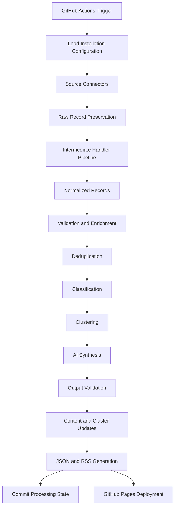

# SignalForge — Architecture Specification

**Project:** SignalForge  
**Architecture Version:** 0.1  
**Deployment Model:** GitHub Pages + GitHub Actions  
**Status:** Proposed

---

## 1. Architecture Objectives

SignalForge must provide a reusable processing engine capable of powering multiple independent intelligence websites.

The architecture must:

- Separate source collection from data processing.
- Separate processing from AI synthesis.
- Support multiple source formats.
- Use standardized intermediate records.
- Allow new handlers without changing the central pipeline.
- Support configurable content profiles.
- Preserve original information and source attribution.
- Maintain evolving clusters and article versions.
- Publish structured data through GitHub Pages.
- Use GitHub Actions for scheduled processing.
- Avoid requiring a continuously running backend server.

The initial architecture should be a modular application rather than a distributed microservices system.

## 2. Deployment Architecture

The initial deployment consists of three main parts.

### 2.1 Public frontend

Hosted through GitHub Pages.

Responsibilities:

- Display published intelligence.
- Display article pages.
- Display categories and tags.
- Provide search and filtering.
- Display source references.
- Load generated JSON.
- Expose generated RSS feeds.
- Apply installation-specific branding and themes.

The frontend must be static.

It must not contain AI credentials, private configuration or internal processing state.

### 2.2 Processing environment

GitHub Actions executes the collection and processing pipeline.

Responsibilities:

- Load installation configuration.
- Collect information from sources.
- Execute intermediate handlers.
- Normalize and validate records.
- Detect duplicates.
- Identify related records.
- Perform AI processing.
- Update clusters.
- Generate published content.
- Generate JSON and RSS output.
- Commit persistent processing state.
- Deploy updated public content.

### 2.3 Repository storage

The GitHub repository provides version-controlled storage for:

- Configuration.
- Source definitions.
- Content profiles.
- Processing state.
- Raw and normalized records where retained.
- Cluster membership.
- Article versions.
- Generated public data.
- Themes and frontend assets.

The repository must distinguish internal processing data from public publishing output.

Only the intended public output should be deployed through GitHub Pages.

---

## 3. High-Level System Flow



All source records must pass through the intermediate handler pipeline.

No connector should invoke the synthesis model directly.

---

## 4. Application Modules

### 4.1 Configuration Manager

Loads and validates installation-specific configuration.

Responsibilities:

- Website identity.
- Source configuration.
- Collection schedules.
- AI provider settings.
- Content profiles.
- Handler configuration.
- Deduplication rules.
- Publishing settings.
- Theme configuration.
- Data retention settings.

Configuration must be separated from application code.

Sensitive credentials must be provided through GitHub Secrets and environment variables.

### 4.2 Source Connector Manager

Provides a common interface for fetching information from different source types.

Initial connectors:

- RSS.
- Atom.
- JSON APIs.
- Basic HTML extraction.

Future connectors may include scientific databases, publication APIs, job portals, patent databases, government sources and other structured information providers.

A connector is responsible only for obtaining source information and returning source-specific records.

It must not perform AI synthesis or directly create published articles.

### 4.3 Raw Record Store

Preserves the original collected information before transformation.

Responsibilities:

- Record source identity.
- Preserve original URLs.
- Preserve relevant fetched content.
- Record collection timestamps.
- Preserve original metadata.
- Generate stable record identifiers.
- Track connector execution.

Raw records must remain distinguishable from normalized records.

For large responses, the platform should support storing only the necessary source payload and metadata rather than blindly retaining entire responses.

### 4.4 Intermediate Handler Engine

The intermediate handler engine is a mandatory architectural component.

It sits between source connectors and downstream intelligence processing.

It converts heterogeneous source data into standardized records.

Handler categories:

1. Parsing.
2. Extraction.
3. Normalization.
4. Enrichment.
5. Validation.
6. Filtering.
7. Fingerprinting.
8. Deduplication preparation.
9. Domain-specific transformation.

#### Handler interface

Each handler should receive:

- Current record.
- Source metadata.
- Installation configuration.
- Content profile.
- Processing context.

Each handler should return:

- Transformed record.
- Processing status.
- Validation messages.
- Warnings.
- Relevant metadata.
- Processing diagnostics.

Handlers should be independently testable.

#### Handler execution

Handlers should be configurable and composable.

The pipeline must support:

- Sequential handlers.
- Conditional handlers.
- Optional handlers.
- Required handlers.
- Source-specific handlers.
- Content-profile-specific handlers.

A failed required handler should prevent an invalid record from reaching downstream processing.

A failed optional enrichment handler may allow processing to continue with a warning.

#### Future handler examples

- PDF text extraction.
- Scientific abstract extraction.
- Full-text document extraction.
- HTML article extraction.
- Table extraction.
- Image metadata extraction.
- Transcript extraction.
- Language detection.
- Translation.
- Domain-specific entity extraction.

New integrations should add connectors and handlers instead of creating separate processing pipelines.

### 4.5 Normalized Record Model

All accepted source records must eventually conform to a common internal representation.

Indicative fields:

```json
{
  "record_id": "stable-record-id",
  "installation_id": "installation-id",
  "source_id": "source-id",
  "source_type": "rss",
  "source_url": "https://example.org/article",
  "original_id": "source-specific-id",
  "title": "Example title",
  "description": "Normalized description",
  "content": "Available extracted content",
  "published_at": "2026-11-20T10:00:00Z",
  "collected_at": "2026-11-20T11:00:00Z",
  "authors": [],
  "categories": [],
  "entities": [],
  "identifiers": {},
  "fingerprints": {},
  "processing_status": "validated",
  "profile": "technology"
}
```

The schema should allow domain-specific extensions without making every field mandatory.

Original source content and normalized content must remain separately accessible.

### 4.6 Deduplication Engine

Responsible for identifying records that represent the same underlying content.

Methods may include:

- Canonical URL matching.
- Original source identifier matching.
- DOI or PMID matching.
- Job identifier matching.
- Content fingerprinting.
- Title similarity.
- Metadata similarity.
- Configurable AI-assisted evaluation.

Exact deterministic matches should be resolved before expensive AI evaluation.

Deduplication must be separate from related-record clustering.

Two records may be related without being duplicates.

### 4.7 Classification Engine

Classifies validated records using content profiles.

Responsibilities:

- Identify record type.
- Identify relevant categories.
- Extract entities.
- Assign domain-specific attributes.
- Determine processing eligibility.
- Identify relevant cluster candidates.

Classification rules should support deterministic and AI-assisted methods.

### 4.8 Clustering Engine

Groups records describing the same or related underlying information.

Responsibilities:

- Create clusters.
- Identify candidate existing clusters.
- Associate new records.
- Update cluster metadata.
- Detect incorrectly merged records.
- Support cluster splitting.
- Support cluster merging.
- Maintain cluster history.

Cluster rules must be content-profile dependent.

Scientific papers with different methods or findings must not automatically be treated as duplicate studies.

### 4.9 AI Provider Adapter

Provides a common interface for AI services.

Initial implementation should support Google Gemini.

The architecture should allow additional providers through adapters.

Responsibilities:

- Provider configuration.
- Model configuration.
- API request handling.
- Response parsing.
- Error handling.
- Retry handling.
- Usage tracking where available.
- Structured response validation.

AI requests should be task-specific.

Examples:

- Classification.
- Entity extraction.
- Duplicate evaluation.
- Cluster evaluation.
- Synthesis.
- Article updates.

AI credentials must only be available to the GitHub Actions runtime.

### 4.10 Synthesis Engine

Generates consolidated content from validated records belonging to a cluster.

Responsibilities:

- Build task-specific AI inputs.
- Include relevant source information.
- Generate structured article content.
- Preserve source references.
- Identify conflicting information.
- Distinguish confirmed facts from interpretation.
- Validate output.
- Compare with existing content.
- Determine whether an update is necessary.

The synthesis engine must not invent source references.

Every published source reference must map to an actual collected record.

### 4.11 Content Version Manager

Maintains the history of synthesized content.

Responsibilities:

- Create article records.
- Update existing articles.
- Preserve previous versions.
- Track contributing source records.
- Track update timestamps.
- Identify significant changes.
- Support restoration of previous versions.

New source information should not automatically result in an entirely new article.

### 4.12 Publishing Engine

Transforms approved content into public website data.

Outputs:

- Article JSON.
- Index JSON.
- Category JSON.
- Tag JSON.
- Search data.
- Related article references.
- RSS feeds.
- Sitemap.
- Public metadata.

The publishing engine must not expose internal records or credentials.

---

## 5. Processing State and Data Model

The following logical entities should be considered.

| Entity | Purpose |
|---|---|
| Installation | Website identity |
| Site Configuration | Website-specific settings |
| Source | Information source definition |
| Source Run | Collection execution history |
| Raw Record | Original collected information |
| Normalized Record | Standardized information |
| Processing Event | Handler execution and diagnostics |
| Entity | Extracted organization, person, product or subject |
| Cluster | Underlying information grouping |
| Cluster Record | Record-to-cluster relationship |
| Article | Published intelligence record |
| Article Version | Historical article content |
| Source Attribution | Published source relationships |
| Content Profile | Domain-specific processing rules |
| AI Task Configuration | Provider, model and instructions |
| Theme | Presentation configuration |

Each entity should have a stable identifier.

Processing state must support recovery from interrupted workflow executions.

---

## 6. GitHub Actions Architecture

### 6.1 Scheduled workflow

The primary workflow should run hourly by default.

The schedule must be configurable.

GitHub Actions scheduled workflows can be delayed, so processing must not depend on execution at an exact minute.

### 6.2 Manual workflow execution

Administrators should be able to initiate collection manually through GitHub Actions.

Potential inputs:

- Full collection.
- Selected sources.
- Reprocess failed records.
- Reprocess selected records.
- Rebuild public output.
- Rebuild search index.
- Regenerate RSS.
- Validate configuration.

### 6.3 Workflow stages

A workflow should execute logically separated jobs or steps:

1. Checkout repository.
2. Load configuration.
3. Validate configuration.
4. Restore processing state.
5. Fetch configured sources.
6. Preserve raw records.
7. Run intermediate handlers.
8. Validate normalized records.
9. Perform deduplication.
10. Classify records.
11. Identify clusters.
12. Perform eligible AI operations.
13. Validate AI output.
14. Update clusters and articles.
15. Generate public output.
16. Commit persistent state.
17. Deploy GitHub Pages.

Stages should be independently testable.

### 6.4 Workflow concurrency

Concurrent processing runs must not overwrite each other's state.

Use GitHub Actions concurrency controls.

The workflow should prevent multiple publishing runs from simultaneously modifying the same generated files.

### 6.5 Permissions

Workflow permissions should be restricted to the minimum required.

The processing workflow may need repository content write access and Pages deployment permissions.

Public frontend access must not grant access to private processing data.

### 6.6 Secrets

AI API keys should be stored in GitHub Actions Secrets.

Example environment variable:

`GEMINI_API_KEY`

Secrets must not be:

- Written into configuration files.
- Committed to the repository.
- Included in generated JSON.
- Exposed through frontend JavaScript.
- Printed in workflow logs.

### 6.7 Failure recovery

The workflow must:

- Log failed source requests.
- Retry transient failures.
- Preserve processing checkpoints.
- Avoid reprocessing completed records unnecessarily.
- Prevent duplicate publishing.
- Continue independent source processing when another source fails.
- Report partial failures clearly.

---

## 7. Repository and Storage Strategy

The initial storage model is repository-based.

This is suitable for an initial low-to-moderate volume deployment but must be treated as a constrained storage environment.

### 7.1 Configuration storage

Configuration should be stored in version-controlled files.

Examples:

- Site identity.
- Source definitions.
- Content profiles.
- Handler configuration.
- AI task instructions.
- Publishing settings.
- Theme configuration.

Secrets must remain outside repository files.

### 7.2 Internal processing data

Internal state should be separated from public generated content.

Potential directories:

```text
data/
├── raw/
├── normalized/
├── entities/
├── clusters/
├── articles/
├── history/
├── checkpoints/
└── logs/
```

The repository may store compact records and processing state.

Large binary source documents and extensive extracted content should not be retained indefinitely in Git.

### 7.3 Public output

Only approved content should be placed in the public publishing directory.

```text
public/
├── data/
├── articles/
├── categories/
├── tags/
├── search/
├── feeds/
└── sitemap.xml
```

The Pages deployment must publish only the intended public artifact.

### 7.4 Storage limitations

Repository storage must be monitored.

Potential issues include:

- Repository growth.
- Large Git histories.
- Long checkout times.
- Large generated JSON files.
- Concurrent workflow conflicts.
- Expensive full rebuilds.

Use compact JSON, incremental processing, sensible retention and generated indexes.

Avoid committing temporary files, caches and unnecessary execution logs.

---

## 8. Frontend Architecture

The frontend should be a static application that consumes generated public data.

It must not require a continuously available backend.

### 8.1 Frontend responsibilities

- Display latest intelligence.
- Display article details.
- Display categories and tags.
- Search published content.
- Filter content.
- Display related records.
- Display source attribution.
- Load RSS feed links.
- Render themes.
- Support responsive layouts.

### 8.2 Data consumption

The frontend should read generated JSON files.

It must not read internal processing files.

The data interface should be versioned so frontend and processing changes remain compatible.

### 8.3 Routing

The frontend should support static routes.

Potential routes:

```text
/
 /articles/
 /articles/example-article/
 /categories/
 /categories/technology/
 /tags/
 /search/
 /about/
```

Article pages should be generated or made available through a static-compatible routing strategy.

### 8.4 Theme rendering

Themes should be independent of processing logic.

The same published data should be usable by different themes without rerunning collection or synthesis.

---

## 9. Independent Installation Model

Each website installation should have its own GitHub repository.

Each installation has:

- Its own configuration.
- Its own source list.
- Its own GitHub Secrets.
- Its own processing state.
- Its own generated content.
- Its own Pages deployment.
- Its own theme and branding.

The platform source should be reusable across installations.

A central platform repository may provide versioned processing components and reusable GitHub Actions workflows.

Each installation should explicitly select the platform version it uses.

For the initial implementation, a straightforward repository template or pinned shared workflow is preferable to complex multi-repository orchestration.

---

## 10. Security Boundaries

The architecture must distinguish between:

**Private execution environment**

- API credentials.
- Internal source configuration.
- Raw records not intended for publication.
- Processing state.
- Logs.
- Drafts.
- Internal diagnostics.

**Public publishing environment**

- Approved articles.
- Public source references.
- Categories.
- Tags.
- Search indexes.
- RSS feeds.
- Public metadata.

Only public publishing output should be deployed to GitHub Pages.

Repository write access must be restricted because workflows may access repository secrets.

External URLs and fetched content must be treated as untrusted input.

Uploaded themes must not be allowed to execute arbitrary code.

---

## 11. Testing Strategy

### Unit tests

- Individual source connectors.
- Individual processing handlers.
- Normalization.
- Validation.
- Fingerprinting.
- Deduplication.
- Classification.
- Clustering.
- Publishing output.

### Integration tests

- Source connector to intermediate record.
- Intermediate handler pipeline.
- Record-to-cluster association.
- AI provider response validation.
- Article generation.
- Article version updates.
- JSON generation.
- RSS generation.

### Workflow tests

- Scheduled workflow configuration.
- Manual execution.
- Partial source failure.
- AI provider failure.
- Retry behaviour.
- Interrupted processing.
- Concurrent execution prevention.
- Pages deployment.

### Data integrity tests

- Original records remain unchanged.
- Every published source reference exists.
- Duplicate processing does not create duplicate articles.
- Cluster updates preserve previous history.
- Private data is excluded from public output.

---

## 12. Architectural Constraints

1. No direct source connector-to-AI integration.
2. Intermediate handlers are mandatory.
3. Raw records and normalized records remain separate.
4. Deduplication and related-record clustering remain distinct.
5. AI providers are replaceable.
6. Content profiles are configurable.
7. Source attribution is traceable.
8. Published articles are versioned.
9. Processing is safe to retry.
10. Public frontend data is separated from internal state.
11. GitHub Actions is the initial execution environment.
12. GitHub Pages is the initial publishing environment.
13. Repository storage is treated as a constrained initial storage model.
14. The platform should remain modular without premature microservices.

**Architecture principle:** Source connectors acquire information. Intermediate handlers make it usable. Intelligence modules establish relationships. AI synthesizes validated information. Publishing modules expose approved results.
